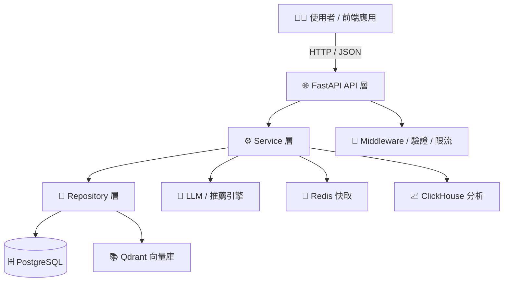

# DaoDao AI Backend

DaoDao AI Backend 是島島教育平台的後端服務，提供 AI 增強的教育功能，包含推薦系統、實踐追蹤與 LLM 整合。

## 專案結構

```
src/
├── routers/    # FastAPI 路由層
├── middleware/ # 中介層（JWT 驗證、速率限制等）
├── models/     # ORM 模型（對應 daodao-storage）
├── db/         # 資料庫相關程式
├── schemas/    # Pydantic 資料結構定義（request / response schema）
├── services/   # 業務邏輯與外部整合（LLM、Redis、ClickHouse）
└── utils/      # 共用工具函數
```

## 系統架構



## 環境要求

- Python 3.10+（推薦 3.12）
- [uv](https://docs.astral.sh/uv/) — 套件管理
- Docker / Docker Compose
- PostgreSQL（主資料庫）
- Redis（快取 / 限流）
- Qdrant（向量搜尋）
- ClickHouse（分析資料庫，選用）

## 快速開始

1. 克隆專案

```bash
git clone https://github.com/daodaoedu/daodao-ai-backend.git
cd daodao-ai-backend
```

2. 配置環境變數

```bash
cp .env.dev.sample .env.dev    # 開發環境
cp .env.prod.sample .env.prod  # 生產環境
# 編輯對應的 .env 檔案，設定資料庫、API key 等參數
```

3. 使用 Docker 啟動服務

```bash
make up-dev   # 啟動開發環境（port 8002）
make up-prod  # 啟動生產環境
```

其他常用指令：

```bash
make rebuild-dev   # 重建開發環境
make health        # 健康檢查（dev + prod）
make quality_checks # 程式碼格式化 + 靜態分析
make help          # 列出所有可用指令
```

## API 端點

所有端點皆掛載於 `/api/v1` 前綴。

### Health

| Method | Path | 說明 |
|--------|------|------|
| GET | `/ping` | 基本連線測試，回傳 `pong` |
| GET | `/health` | 完整健康檢查（含 DB 連線狀態） |

### Users

| Method | Path | 說明 |
|--------|------|------|
| GET | `/users/practices/suggestions` | 搜尋關鍵字建議（熱門標籤 + 個人興趣標籤） |
| GET | `/users/practices/completions` | 輸入框即時關鍵字補全（`q`, `limit`） |
| GET | `/users/practices` | 取得使用者練習貼文列表（支援分頁、篩選、排序） |

### Recommendation

| Method | Path | 說明 | 速率限制 |
|--------|------|------|---------|
| GET | `/recommendation/rank_feed` | 取得個人化 Feed 推薦（idea / practice / project） | 60/min |

### Feedback

| Method | Path | 說明 | 速率限制 |
|--------|------|------|---------|
| POST | `/feedback/generate` | 非同步產生 AI 回饋（reviewId、style、thinkingMethod） | 5/min |
| GET | `/feedback/status/{task_id}` | 查詢回饋任務狀態 | 60/min |
| GET | /feedback/{review_id} | 取得指定 Review 的回饋詳情 | 20/min |

## 服務層說明

| Service | 說明 |
|---------|------|
| `rank_feed.py` | Feed 排名演算法（新鮮度、活躍度、基礎分數） |
| `feedback.py` | 組裝 AI 回饋所需的完整 context（Review、Project、Milestone、Task） |
| `process_feedback.py` | 背景任務：呼叫 LLM 並儲存回饋結果 |
| `review_service.py` | 使用 LLM Prompt 產生個人化 Review 回饋 |
| `resource_service.py` | 取得熱門 / 最新 / 推薦資源 |
| `practice/` | 練習相關推薦邏輯 |

## 開發指南

### 資料模型

`src/models/` 目錄下的 ORM 模型需與 [daodao-storage](https://github.com/daodaoedu/daodao-storage) 的 schema 保持一致，新增或修改模型時請同步更新兩個倉庫。

### LLM 後端

支援多後端切換，透過 `.env` 設定：

- **Ollama**（預設本地開發）
- **OpenAI**
- **Gemini**
- **Grok**

### 程式碼品質

```bash
make format   # 格式化（ruff + black）
make lint     # 靜態分析（pylint + bandit）
```

- `src/models/` 下的資料模型需要與 [daodao-storage](https://github.com/daodaoedu/daodao-storage) 倉庫的 schema 保持一致
- 新增或修改模型時，請確保同步更新兩個倉庫

API 文件訪問地址：

| 環境 | Swagger UI | ReDoc |
|------|-----------|-------|
| 本地開發 | http://localhost:8002/docs | http://localhost:8002/redoc |
| Dev | https://ai-dev.daodao.so/docs | https://ai-dev.daodao.so/redoc |
| Production | https://ai.daodao.so/docs | https://ai.daodao.so/redoc |

> Swagger 的 server 選單會依 `ENVIRONMENT` 環境變數自動切換：
> - `development`（預設）：顯示 `https://ai-dev.daodao.so` 與 `http://127.0.0.1:8002`
> - `production`：僅顯示 `https://ai.daodao.so`

## 授權條款

本專案採用 MIT 授權條款 - 查看 [LICENSE](LICENSE) 檔案瞭解詳情
