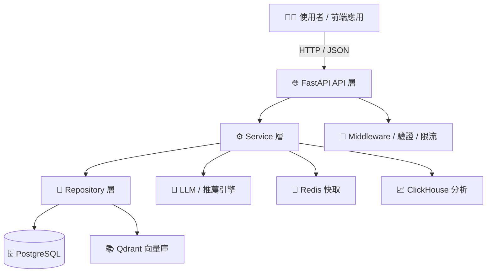

# DaoDao AI Backend

DaoDao AI Backend 是道道教育平台的後端服務，提供 AI 增強的教育服務功能。

## 專案結構

```
app/
├── api/ # FastAPI 路由層 (routers)
├── core/ # 基礎設置：config, logger, limiter, dependencies
├── models/ # ORM 模型 (對應 daodao-storage)
├── repositories/ # 資料庫操作層 (PostgreSQL / Qdrant)
├── schemas/ # Pydantic 資料結構定義
├── services/ # 業務邏輯與外部整合 (LLM, Redis, ClickHouse)
├── middlewares/ # 中介層 (JWT 驗證、速率限制等)
└── utils/ # 共用工具函數
```

## 🧩 系統架構




## 環境要求

- Python 3.9+
- Docker / Docker Compose
- PostgreSQL（主資料庫）
- Redis（快取 / 限流）
- Qdrant（向量搜尋）

## 快速開始

1. 克隆專案
```bash
git clone https://github.com/daodaoedu/daodao-ai-backend.git
cd daodao-ai-backend
```

2. 配置環境變數
```bash
cp .env.example .env
# 編輯 .env 檔案，設定資料庫、API key 等參數
```

3. 使用 Docker 啟動服務
```bash
docker-compose up -d
```

## 開發指南

### 本地開發
```bash
# 安裝相依套件
pip install -r app/requirements.txt

# 啟動開發伺服器
uvicorn app.main:app --reload
```

### 資料模型說明
- `app/models` 目錄下的資料模型需要與 [daodao-storage](https://github.com/daodaoedu/daodao-storage) 倉庫的 schema 保持一致
- 在新增或修改模型時，請確保同步更新兩個倉庫

## 文件

API 文件訪問地址：
- Swagger UI: http://localhost:8000/docs
- ReDoc: http://localhost:8000/redoc

## 授權條款

本專案採用 MIT 授權條款 - 查看 [LICENSE](LICENSE) 檔案瞭解詳情
