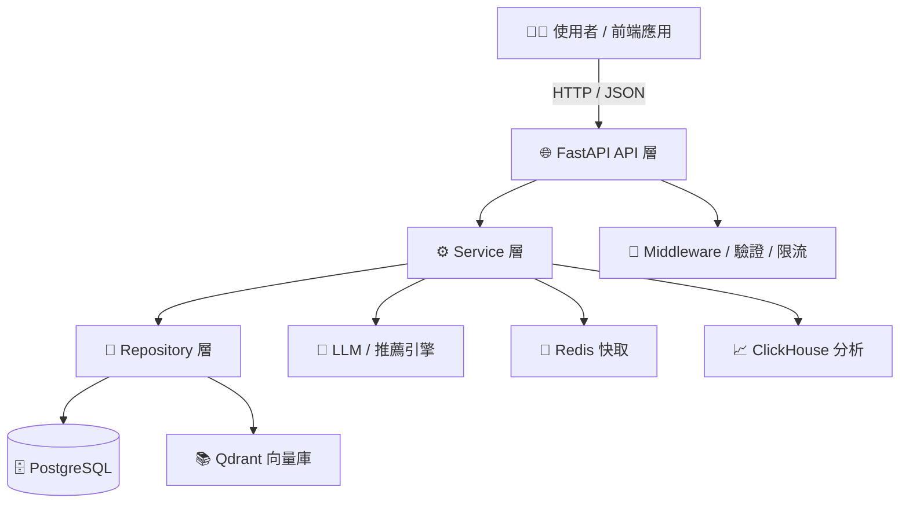

# DaoDao AI Backend

DaoDao AI Backend 是島島教育平台的後端服務，提供 AI 增強的教育功能，包含推薦系統、實踐追蹤與 LLM 整合。

## 專案結構

```
src/
├── routers/        # FastAPI 路由層（users, recommendation, ping）
├── middleware/     # 中介層（JWT 驗證、速率限制）
├── models/         # SQLAlchemy ORM 模型（對應 daodao-storage schema）
├── schemas/        # Pydantic request / response 資料結構
├── services/       # 業務邏輯
│   ├── practice/   # 實踐查詢、推薦邏輯
│   ├── cache/      # Redis 快取
│   ├── llm/        # LLM 整合
│   ├── qdrant/     # 向量搜尋
│   └── clickhouse/ # 分析資料庫
├── db/             # 資料庫連線
├── utils/          # 共用工具函數
└── config.py       # 設定（pydantic-settings）
```

## 系統架構



## 環境要求

- Python 3.10+（推薦 3.12）
- [uv](https://docs.astral.sh/uv/) — 套件管理
- Docker / Docker Compose
- PostgreSQL（主資料庫）
- Redis（快取 / 限流）
- Qdrant（向量搜尋）
- ClickHouse（分析資料庫，選用）

## 快速開始

1. 克隆專案

```bash
git clone https://github.com/daodaoedu/daodao-ai-backend.git
cd daodao-ai-backend
```

2. 安裝依賴
```bash
uv sync
```

3. 配置環境變數
```bash
cp .env.dev .env
# 編輯 .env，設定資料庫、Redis、API key 等參數
```

4. 安裝 pre-commit hooks（確保 commit 前自動格式化）
```bash
uvx pre-commit install
```

5. 使用 Docker 啟動服務
```bash
# 開發環境
make up-dev

# 正式環境
make up-prod
```

## API 端點

所有端點皆掛載於 `/api/v1` 前綴。

### Health

| Method | Path | 說明 |
|--------|------|------|
| GET | `/ping` | 基本連線測試，回傳 `pong` |
| GET | `/health` | 完整健康檢查（含 DB 連線狀態） |

### Users

| Method | Path | 說明 |
|--------|------|------|
| GET | `/users/practices/suggestions` | 搜尋關鍵字建議（熱門標籤 + 個人興趣標籤） |
| GET | `/users/practices/completions` | 輸入框即時關鍵字補全（`q`, `limit`） |
| GET | `/users/practices` | 取得使用者練習貼文列表（支援分頁、篩選、排序） |

### Recommendation

| Method | Path | 說明 | 速率限制 |
|--------|------|------|---------|
| GET | `/recommendation/rank_feed` | 取得個人化 Feed 推薦（idea / practice / project） | 60/min |

### Feedback

| Method | Path | 說明 | 速率限制 |
|--------|------|------|---------|
| POST | `/feedback/generate` | 非同步產生 AI 回饋（reviewId、style、thinkingMethod） | 5/min |
| GET | `/feedback/status/{task_id}` | 查詢回饋任務狀態 | 60/min |
| GET | /feedback/{review_id} | 取得指定 Review 的回饋詳情 | 20/min |

## 服務層說明

| Service | 說明 |
|---------|------|
| `rank_feed.py` | Feed 排名演算法（新鮮度、活躍度、基礎分數） |
| `feedback.py` | 組裝 AI 回饋所需的完整 context（Review、Project、Milestone、Task） |
| `process_feedback.py` | 背景任務：呼叫 LLM 並儲存回饋結果 |
| `review_service.py` | 使用 LLM Prompt 產生個人化 Review 回饋 |
| `resource_service.py` | 取得熱門 / 最新 / 推薦資源 |
| `practice/` | 練習相關推薦邏輯 |

## 開發指南

### 常用指令

| 指令 | 說明 |
|------|------|
| `make up-dev` | 啟動開發環境 |
| `make down-dev` | 停止開發環境 |
| `make rebuild-dev` | 重建開發環境 |
| `make format` | 格式化程式碼（black + ruff） |
| `make check` | 檢查格式（不修改） |
| `make lint` | 靜態分析（pylint + bandit） |
| `make quality_checks` | format + lint 一鍵執行 |

### 程式碼規範

- 格式化工具：`black 25.9.0`、`ruff`
- commit 前 pre-commit hook 會自動執行 black，確保格式一致
- CI 會執行 `make check` 驗證格式，格式錯誤會擋住 merge

### 資料模型說明

- `src/models/` 下的資料模型需要與 [daodao-storage](https://github.com/daodaoedu/daodao-storage) 倉庫的 schema 保持一致
- 新增或修改模型時，請確保同步更新兩個倉庫

## API 文件

服務啟動後可訪問：
- Swagger UI：http://localhost:8002/docs
- ReDoc：http://localhost:8002/redoc

## 授權條款

本專案採用 MIT 授權條款 - 查看 [LICENSE](LICENSE) 檔案瞭解詳情
