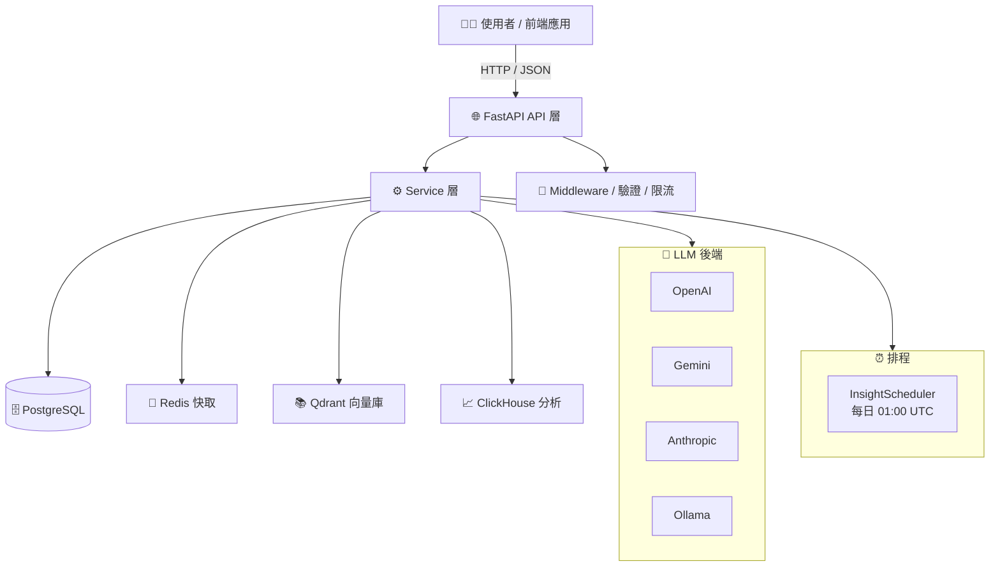

# DaoDao AI Backend

DaoDao AI Backend 是島島教育平台的後端服務，提供 AI 增強的教育功能，包含個人化推薦、實踐追蹤、精選洞察生成與 LLM 整合。

## 專案結構

```
src/
├── routers/       # FastAPI 路由層
├── middleware/    # 中介層（JWT 驗證、速率限制、CORS）
├── models/        # SQLAlchemy ORM 模型（對應 daodao-storage schema）
├── db/            # 資料庫連線與 Session 管理
├── schemas/       # Pydantic 資料結構（request / response）
├── services/      # 業務邏輯與外部整合
│   ├── llm/       # LLM 多後端（OpenAI / Gemini / Anthropic / Ollama）
│   ├── cache/     # Redis 快取
│   ├── qdrant/    # 向量資料庫
│   ├── insight/   # 精選洞察生成與排程
│   ├── feed/      # 統一 Feed 與推薦排名
│   └── practice/  # 實踐查詢與推薦
└── utils/         # 共用工具函數
```

## 系統架構



## 環境要求

- Python 3.12
- [uv](https://docs.astral.sh/uv/) — 套件管理
- Docker / Docker Compose
- PostgreSQL（主資料庫）
- Redis（快取 / 限流）
- Qdrant（向量搜尋，選用）
- ClickHouse（分析資料庫，選用）

## 快速開始

**1. 克隆專案**

```bash
git clone https://github.com/daodaoedu/daodao-ai-backend.git
cd daodao-ai-backend
```

**2. 設定環境變數**

```bash
cp .env.dev.sample .env.dev    # 開發環境
cp .env.prod.sample .env.prod  # 生產環境
# 填入資料庫連線、JWT secret、LLM API key 等
```

**3. 啟動服務**

```bash
make up-dev    # 啟動開發環境（port 8002）
make up-prod   # 啟動生產環境
```

**常用指令**

```bash
make rebuild-dev    # 重建開發環境映像
make health         # 健康檢查（dev + prod）
make format         # 自動修復格式（black + ruff）
make check          # 格式檢查（不修改）
make lint           # 靜態分析（pylint + bandit）

# 精選洞察手動觸發
make insight-run           # 使用 .env.dev 預設 backend
make insight-run-gemini    # 指定 Gemini
make insight-run-openai    # 指定 OpenAI
make insight-run-anthropic # 指定 Anthropic Claude
```

## API 端點

所有端點皆掛載於 `/api/v1` 前綴。

### Health

| Method | Path | 說明 |
|--------|------|------|
| GET | `/ping` | 基本連線測試 |
| GET | `/health` | 完整健康檢查（含 DB 連線狀態） |

### Users

| Method | Path | 說明 | 快取 |
|--------|------|------|------|
| GET | `/users/practices` | 實踐貼文列表（搜尋/篩選/排序/分頁） | 120s |
| GET | `/users/practices/suggestions` | 搜尋關鍵字建議 | 600s |
| GET | `/users/practices/completions` | 即時文字補全 | 300s |
| GET | `/users/insights` | 精選洞察列表（已完成實踐） | 300s |

### Feed

| Method | Path | 說明 | 快取 |
|--------|------|------|------|
| GET | `/feed` | 統一 Feed（practice + checkin 混合，支援個人化推薦） | 120s |

### Recommendation

| Method | Path | 說明 | 速率限制 | 快取 |
|--------|------|------|---------|------|
| GET | `/recommendation/rank_feed` | 個人化 Feed 推薦（idea / practice / project） | 60/min | 60s |

> Feedback 功能目前已停用（`src/routers/feedback.py` 已存在但未掛載）

### API 文件

| 環境 | Swagger UI | ReDoc |
|------|-----------|-------|
| 本地開發 | http://localhost:8002/docs | http://localhost:8002/redoc |
| Dev | https://ai-dev.daodao.so/docs | https://ai-dev.daodao.so/redoc |
| Production | https://ai.daodao.so/docs | https://ai.daodao.so/redoc |

> `ENVIRONMENT` 環境變數控制 Swagger server 清單：`development`（預設）顯示 dev + local，`production` 僅顯示 prod。

## Service 層說明

| Service | 檔案 | 說明 |
|---------|------|------|
| `PracticeService` | `services/practice/practice.py` | 多維查詢、搜尋、推薦排序 |
| `RecommendationService` | `services/practice/recommendation.py` | 混合評分排名（內容 + 行為 + 時間衰減） |
| `FeedService` | `services/feed/feed_service.py` | UNION Feed + 批量 N+1 防護 + 個人化重排 |
| `FeedRankingService` | `services/feed/feed_ranking.py` | 社群圖 × 參與度 × 時間衰減 評分 |
| `InsightService` | `services/insight/insight_service.py` | 打卡統計分析 → Prompt → LLM 洞察生成 |
| `InsightScheduler` | `services/insight/insight_scheduler.py` | APScheduler 每日自動觸發洞察生成 |
| `rank_feed` | `services/rank_feed.py` | 推薦 Feed 評分（idea / practice / project UNION） |
| `LLMClient` | `services/llm/client.py` | 統一 LLM 介面，支援多後端切換 |
| `CacheClient` | `services/cache/client.py` | Redis TTL 快取 |

## LLM 後端設定

透過 `.env` 設定使用哪個 LLM，支援四個後端：

| Backend | 說明 | 環境變數 |
|---------|------|---------|
| **Gemini** | 預設，免費 quota 有限 | `LLM_BACKEND__GEMINI__*` |
| **OpenAI** | GPT-4o | `LLM_BACKEND__OPENAI__*` |
| **Anthropic** | Claude 3.5 Sonnet | `LLM_BACKEND__ANTHROPIC__*` |
| **Ollama** | 本地模型（開發用） | `LLM_BACKEND__OLLAMA__*` |

精選洞察使用的 backend 由 `INSIGHT__LLM_BACKEND` 控制（預設 `gemini`）。

## 精選洞察排程

每日 UTC 01:00 自動執行，為所有 `status='completed'` 且尚無洞察的 Practice 生成個人成長洞察。

```bash
# 手動觸發
make insight-run-openai

# 或直接執行腳本
python scripts/run_insight_job.py --backend openai
python scripts/run_insight_job.py --backend openai --dry-run  # 僅預覽，不實際生成
```

排程時間可透過 `INSIGHT__SCHEDULE_CRON` 設定（預設 `0 1 * * *`）。

## 開發指南

### 資料模型

`src/models/` 下的 ORM 模型需與 [daodao-storage](https://github.com/daodaoedu/daodao-storage) 的 schema 保持一致。新增或修改模型時請同步更新兩個倉庫。

> 專案使用 `create_all()` 自動建表，不需要 migration 工具。

### 程式碼品質

```bash
make format   # 自動修復（black + ruff）
make check    # 僅檢查（black --check + ruff check）
make lint     # 靜態分析（pylint + bandit）
```

commit 前請確認 `make check` 與 `make lint` 皆通過。

## 授權條款

本專案採用 MIT 授權條款 — 查看 [LICENSE](LICENSE) 檔案。
