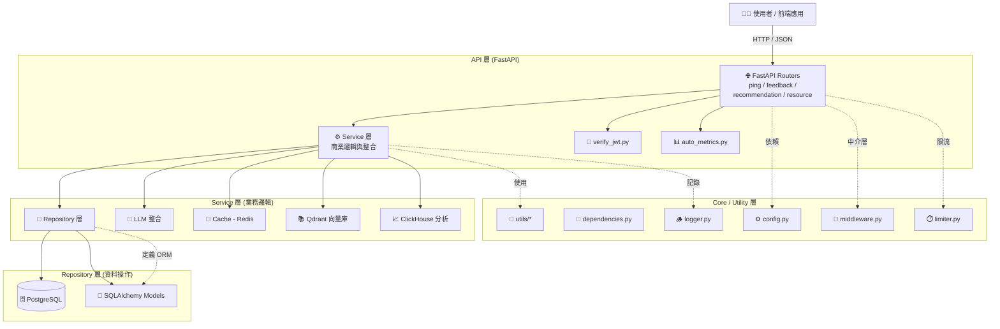

```.
├── app/                          # 主應用程式根目錄
│   ├── api/                      # FastAPI 的路由與 API 邏輯層
│   │   ├── auto_metrics.py       # 自動蒐集/上報 API metrics（例如 latency、request count）
│   │   ├── routers/              # API 路由群組（模組化 endpoints）
│   │   │   ├── __init__.py
│   │   │   ├── feedback.py       # 處理使用者意見或 AI 評論回饋
│   │   │   ├── ping.py           # 健康檢查與服務連線測試端點
│   │   │   ├── recommendation.py # 推薦系統 API（可能呼叫 LLM 或向量查詢）
│   │   │   └── resource.py       # 提供資源清單、標籤、分類等 API
│   │   ├── template.py           # 統一 API 回傳格式裝飾器或樣板
│   │   └── verify_jwt.py         # JWT 驗證與授權邏輯
│   │
│   ├── config.py                 # 全域設定（環境變數、資料庫 URI、快取設定）
│   ├── limiter.py                # API 限流控制（Rate Limiter）
│   ├── middleware.py             # 全域中介層（Logging、CORS、Tracing）
│   │
│   ├── db/                       # 資料庫連線與 ORM 相關
│   │   ├── factory.py            # 建立資料庫 session factory
│   │   ├── interface_db.py       # 資料庫抽象介面（可支援多種後端）
│   │   └── postgresql.py         # PostgreSQL 具體實作
│   │
│   ├── dependencies.py           # FastAPI 依賴注入設定（DB Session、JWT 驗證）
│   ├── Dockerfile                # 應用 Docker build 定義
│   ├── expections.py             # 統一例外與錯誤處理
│   ├── logger.py                 # 日誌系統（Loguru 或 Python logging）
│   ├── logs/                     # 實際日誌輸出目錄
│   ├── main.py                   # FastAPI 啟動主程式（app instance、路由註冊）
│   │
│   ├── models/                   # SQLAlchemy ORM 模型定義（資料表對應）
│   │   ├── base.py               # BaseModel (Declarative Base)
│   │   ├── User.py               # 使用者資料表
│   │   ├── Project.py            # 專案資料表
│   │   ├── Review.py             # 使用者評論
│   │   ├── Resource.py           # 教育資源或課程資料
│   │   ├── ...                   # 其他 domain 模型 (Idea, Task, Category 等)
│   │
│   ├── repositories/             # Repository Pattern：負責資料存取邏輯
│   │   ├── review.py             # Review 資料存取 CRUD
│   │   ├── project.py            # Project 資料層
│   │   ├── milestone.py          # Milestone CRUD
│   │   ├── user.py               # 使用者 CRUD
│   │   └── ...                   # 其他資料操作模組
│   │
│   ├── requirements.txt          # Python 依賴清單
│   │
│   ├── schemas/                  # Pydantic Schema（資料驗證與回傳格式）
│   │   ├── api_response.py       # 統一 API 回傳結構（success, data, message）
│   │   ├── recommendation.py     # 推薦系統輸出格式
│   │   ├── feedback.py           # 回饋 API 輸入/輸出格式
│   │   ├── resource.py           # 資源類型 Schema
│   │   ├── pageInfo.py           # 分頁資訊 Schema
│   │   └── ...                   # 其他子模組輸出格式
│   │
│   ├── services/                 # 商業邏輯層（結合多 Repository 或外部 API）
│   │   ├── feedback.py           # AI 或使用者回饋邏輯
│   │   ├── project.py            # 專案商業邏輯（含驗證、任務鏈結）
│   │   ├── rank_feed.py          # 排名與推薦邏輯（整合多模組）
│   │   ├── review_service.py     # 專門處理評論與 LLM 評估結果
│   │   ├── resource_service.py   # 教育資源相關邏輯
│   │   ├── cache/                # Redis / Cache 工具模組
│   │   │   ├── client.py
│   │   │   └── factory.py
│   │   ├── clickhouse/           # ClickHouse 數據倉儲客戶端
│   │   │   ├── client.py
│   │   │   └── factory.py
│   │   ├── llm/                  # 大語言模型整合層
│   │   │   ├── client.py         # 實際呼叫 LLM API
│   │   │   └── factory.py        # 統一 LLM client 建立
│   │   ├── qdrant/               # 向量資料庫（Qdrant）整合
│   │   │   ├── client.py
│   │   │   └── factory.py
│   │   ├── prompts/              # 提示詞與 RAG 系統文件
│   │   │   ├── prompts.py
│   │   │   └── rag_system.txt
│   │   └── process_feedback.py   # 自動處理 AI 回饋與標註任務
│   │
│   ├── tests/                    # 單元與整合測試
│   │   ├── __init__.py
│   │
│   └── utils/                    # 工具與共用邏輯
│       ├── code_enum.py          # 狀態碼列舉
│       ├── code.py               # 錯誤碼與描述對照
│       ├── llm_router.py         # LLM 模型路由邏輯
│       └── redis_utils.py        # Redis 常用封裝
│
├── cache_data/                   # 快取暫存資料目錄
├── docker-compose.dev.yml        # 開發環境容器編排
├── docker-compose.prod.yml       # 生產環境容器編排
├── Dockerfile                    # 根目錄 Docker 構建設定
├── docs/                         # 文件與筆記
│   ├── arch.md                   # 系統架構說明
│   ├── note.md                   # 開發筆記
│   └── Recommendation.md         # 推薦系統細節
├── Makefile                      # 自動化指令 (run, build, lint, test)
├── pytest.ini                    # pytest 設定檔
└── Readme.md                     # 專案說明文件

```

## Layer break down

| 層級               | 功能說明                         |
| ---------------- | ---------------------------- |
| **API 層**        | 定義 RESTful endpoints，處理請求與回應 |
| **Service 層**    | 包含商業邏輯與外部整合（LLM、快取、向量搜尋）     |
| **Repository 層** | 封裝資料庫 CRUD 操作                |
| **Model 層**      | ORM 模型（SQLAlchemy），定義資料表結構   |
| **Schemas 層**    | Pydantic 資料模型，用於請求/回應驗證      |
| **基礎層**          | 設定檔、日誌、中介層、資料庫連線             |
| **Utils 層**      | 工具與共用邏輯（Redis、錯誤碼、路由輔助）      |



