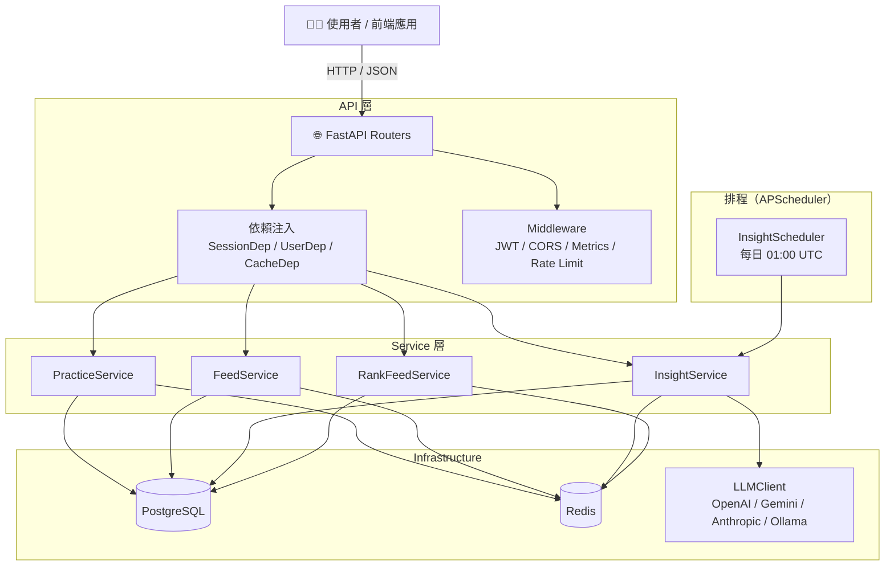

# 系統架構

## 目錄結構

```
.
├── src/
│   ├── main.py                   # FastAPI 應用入口，lifespan 管理（DB / Scheduler 初始化）
│   ├── config.py                 # 環境設定（PostgreSQL / Redis / LLM / Insight 排程）
│   ├── dependencies.py           # FastAPI 依賴注入（SessionDep / UserDep / CacheDep）
│   ├── middleware.py             # CORS、Prometheus metrics、API Key 驗證
│   ├── limiter.py                # SlowAPI 速率限制
│   ├── response_template.py      # 統一 API 回傳格式裝飾器
│   ├── logger.py                 # Loguru / Python logging 封裝
│   ├── expections.py             # 統一例外與錯誤處理
│   │
│   ├── routers/                  # API 路由層（HTTP endpoints）
│   │   ├── ping.py               # 健康檢查（/ping, /health）
│   │   ├── users.py              # 實踐查詢、搜尋建議、精選洞察
│   │   ├── feed.py               # 統一 Feed（practice + checkin）
│   │   ├── insight.py            # 精選洞察列表
│   │   ├── recommendation.py     # 個人化推薦 Feed
│   │   └── feedback.py           # AI 回饋生成（目前停用）
│   │
│   ├── models/                   # SQLAlchemy ORM 模型（對應 daodao-storage schema）
│   │   ├── base.py               # Declarative Base
│   │   ├── User.py
│   │   ├── Practice.py           # status, privacy_status, insight 欄位
│   │   ├── PracticeCheckIn.py    # checkin_date, mood, note
│   │   ├── Project.py / Task.py / Milestone.py
│   │   ├── Review.py / AIReviewFeedback.py
│   │   └── ...                   # 共約 39 個 model
│   │
│   ├── schemas/                  # Pydantic 請求 / 回應 Schema
│   │   ├── api_response.py       # 統一回傳結構
│   │   ├── insight.py
│   │   ├── recommendation.py
│   │   ├── feedback.py
│   │   └── pageInfo.py
│   │
│   ├── services/                 # 業務邏輯層
│   │   ├── rank_feed.py          # 推薦 Feed 評分（idea / practice / project UNION）
│   │   ├── feedback.py           # AI 回饋上下文組裝
│   │   ├── review_service.py     # Review + LLM 評估
│   │   ├── resource_service.py   # 教育資源推薦
│   │   │
│   │   ├── practice/             # 實踐相關
│   │   │   ├── practice.py       # 多維查詢 / 搜尋 / 篩選
│   │   │   └── recommendation.py # 混合推薦評分
│   │   │
│   │   ├── feed/                 # 統一 Feed
│   │   │   ├── feed_service.py   # UNION 查詢 + 批量 N+1 防護
│   │   │   └── feed_ranking.py   # 社群圖 × 參與度 × 時間衰減
│   │   │
│   │   ├── insight/              # 精選洞察
│   │   │   ├── insight_service.py   # 打卡分析 → Prompt → LLM → 寫入 DB
│   │   │   └── insight_scheduler.py # APScheduler，每日 01:00 UTC
│   │   │
│   │   ├── llm/                  # LLM 多後端
│   │   │   ├── base.py           # BaseLLMBackend (ABC)
│   │   │   ├── client.py         # LLMClient 統一介面
│   │   │   ├── openai_backend.py
│   │   │   ├── gemini_backend.py
│   │   │   ├── anthropic_backend.py
│   │   │   └── ollama_backend.py
│   │   │
│   │   ├── prompts/              # Prompt 模板
│   │   │   ├── prompts.py        # RAGPromptBuilder / ResponseParser
│   │   │   ├── rag_system.txt    # AI 回饋系統提示
│   │   │   └── insight_system.txt # 精選洞察系統提示
│   │   │
│   │   ├── cache/                # Redis 快取
│   │   │   ├── client.py
│   │   │   └── factory.py
│   │   │
│   │   ├── qdrant/               # 向量資料庫（選用）
│   │   │   ├── client.py
│   │   │   └── factory.py
│   │   │
│   │   └── clickhouse/           # 分析資料庫（選用）
│   │       ├── client.py
│   │       └── factory.py
│   │
│   ├── db/                       # 資料庫連線
│   │   ├── factory.py            # make_database()
│   │   ├── interface_db.py       # 抽象介面
│   │   └── postgresql.py         # PostgreSQL + SQLAlchemy
│   │
│   └── utils/                    # 共用工具
│       ├── code_enum.py
│       └── code.py
│
├── scripts/
│   └── run_insight_job.py        # 精選洞察手動觸發腳本
│
├── docs/                         # 文件
│   ├── arch.md                   # 本檔，系統架構
│   ├── pipeline.md               # 功能 Pipeline 與 Service 詳解
│   ├── Recommendation.md         # 推薦演算法說明
│   └── note.md                   # 資料庫選型設計筆記
│
├── docker-compose.dev.yml
├── docker-compose.prod.yml
├── Makefile
└── Readme.md
```

---

## 分層架構

| 層級 | 說明 |
|------|------|
| **API 層**（routers） | RESTful endpoints，處理 HTTP 請求/回應、快取、依賴注入 |
| **Service 層** | 業務邏輯，整合 DB / LLM / Redis / Qdrant |
| **Model 層** | SQLAlchemy ORM，對應 PostgreSQL 資料表 |
| **Schema 層** | Pydantic，request/response 驗證與序列化 |
| **Infrastructure 層** | DB 連線、Redis、Qdrant、ClickHouse、LLM backends |
| **Core 層** | config、middleware、logger、limiter、dependencies |

---

## 架構流程圖



---

## 資料庫選型

| 資料庫 | 用途 |
|--------|------|
| **PostgreSQL** | 主資料庫：User / Practice / Checkin / Project 等所有業務資料 |
| **Redis** | API 快取（60s–600s TTL）、AI 回饋任務狀態追蹤 |
| **Qdrant** | 向量搜尋（語義相似度搜尋，選用） |
| **ClickHouse** | 大規模事件分析（選用，目前未完全啟用） |

---

## 快取策略

所有快取邏輯在 Router 層實作，失效時自動降級至 DB 查詢。

| 端點 | TTL | Cache Key |
|------|-----|-----------|
| `/users/practices` | 120s | `user_id:filters:sort:cursor` |
| `/feed` | 120s | `user_id:filters:sort:cursor` |
| `/users/insights` | 300s | `user_id:limit:offset` |
| `/users/practices/suggestions` | 600s | `user_id:keyword` |
| `/users/practices/completions` | 300s | `user_id:prefix` |
| `/recommendation/rank_feed` | 60s | `user_id:cursor` |

---

## LLM 多後端

`LLMClient` 統一介面，透過 `backend` 參數切換：

```
LLMClient.generate(prompt, **kwargs)
  └─ 依 backend 名稱路由
      ├─ openai     → AsyncOpenAI（responses.create）
      ├─ gemini     → google-genai（models.generate_content）
      ├─ anthropic  → AsyncAnthropic（messages.create）
      └─ ollama     → httpx（本地，無官方 async SDK）
```

回傳格式統一：`(output: str, cost: float, usage: dict, backend_name: str)`

---

## 認證機制

- **JWT（HS256）**：解析 `_id` → 查詢 `User.external_id`
- **生產環境**：需附帶 `x-api-key` header
- **匿名模式**：支援無 token 瀏覽（`UserDep` optional）
