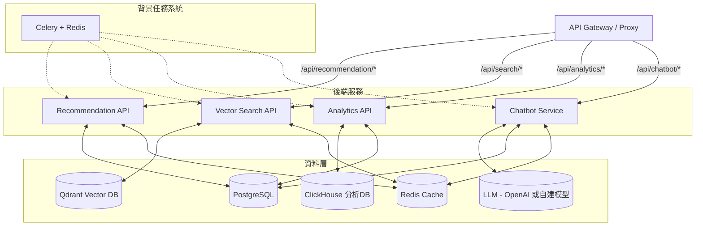
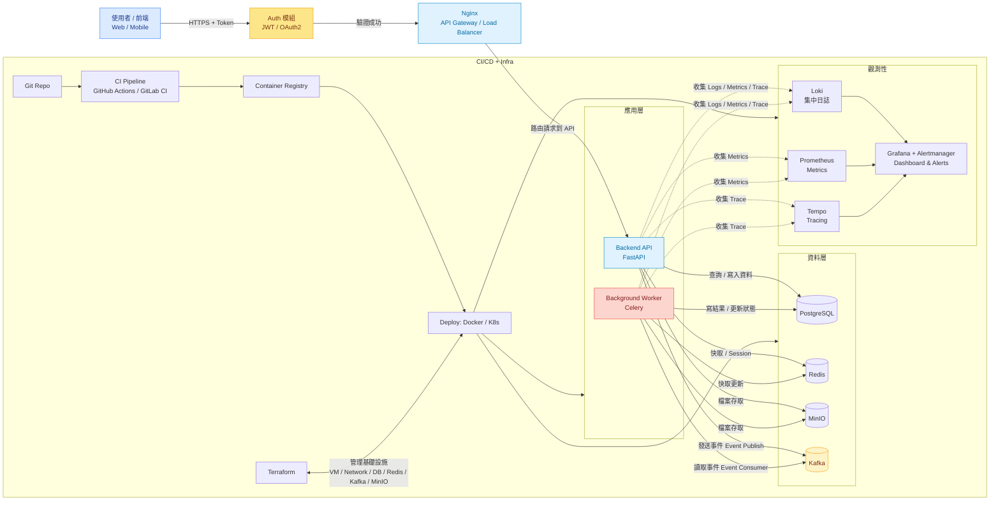

```
app/
├── api/                       # API 路由相關，依功能子目錄拆分
│   ├── __init__.py
│   ├── recommendation/        # 推薦系統相關路由
│   │   ├── __init__.py
│   │   ├── endpoints.py       # 推薦 API endpoints
│   │   └── schemas.py         # 推薦相關的 Pydantic schema
│   ├── analytics/             # 分析系統相關路由
│   │   ├── __init__.py
│   │   ├── endpoints.py       # 分析 API endpoints
│   │   └── schemas.py
│   ├── chatbot/               # 聊天機器人相關路由
│   │   ├── __init__.py
│   │   ├── endpoints.py
│   │   └── schemas.py
│   └── common/                # 公共路由或共用 API
│       ├── __init__.py
│       ├── endpoints.py
│       └── schemas.py
│
├── core/                      # 核心設定與配置
│   ├── __init__.py
│   ├── config.py              # 環境設定（讀取 .env）
│   ├── security.py            # 認證、授權相關
│   └── logger.py              # 日誌設定
│
├── models/                    # 資料庫 ORM 模型（SQLAlchemy）
│   ├── __init__.py
│   ├── base.py                # Base ORM class
│   ├── user.py
│   ├── resource.py
│   ├── recommendation.py
│   ├── analytics.py
│   └── chatbot.py
│
├── services/                  # 業務邏輯與 AI 服務實作
│   ├── __init__.py
│   ├── recommendation_service.py
│   ├── analytics_service.py
│   ├── chatbot_service.py
│   ├── embedding_service.py   # 向量化模型
│   └── etl_service.py         # 資料同步與 ETL 流程
│
├── utils/                     # 工具函式與共用模組
│   ├── __init__.py
│   ├── db.py                  # 資料庫連線與 session 管理
│   ├── redis_utils.py         # Redis 相關工具
│   ├── qdrant_utils.py        # Qdrant 向量庫操作
│   └── llm_utils.py           # LLM 輔助函式
│
├── workers/                   # 非同步任務工作者 (Celery task 等)
│   ├── __init__.py
│   ├── tasks.py
│   └── celery_app.py
│
├── tests/                     # 測試程式碼
│   ├── __init__.py
│   ├── test_recommendation.py
│   ├── test_analytics.py
│   └── test_chatbot.py
│
├── main.py                    # FastAPI 入口，註冊各路由
├── Dockerfile                 # 建置映像檔
├── docker-compose.yml         # 多服務容器定義
├── requirements.txt
├── .env.example
└── README.md
```


